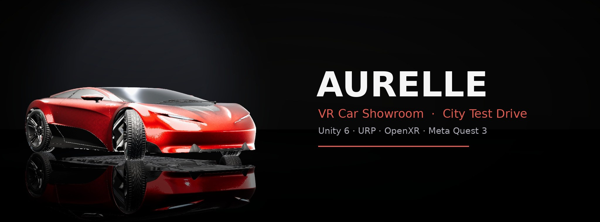
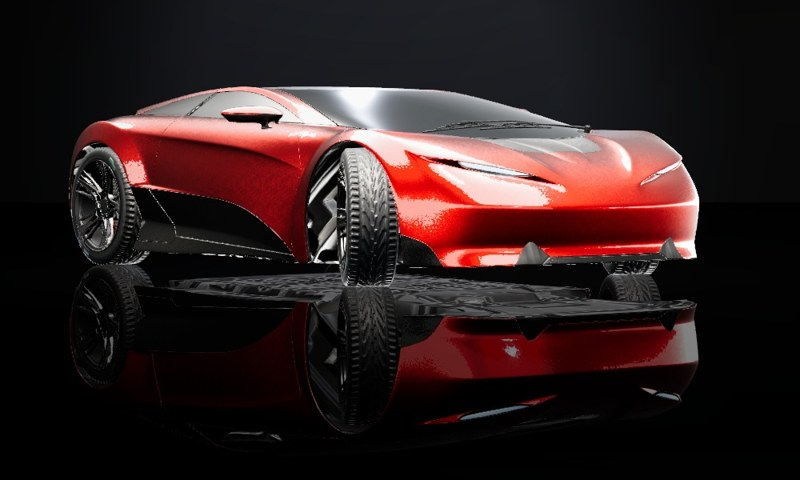
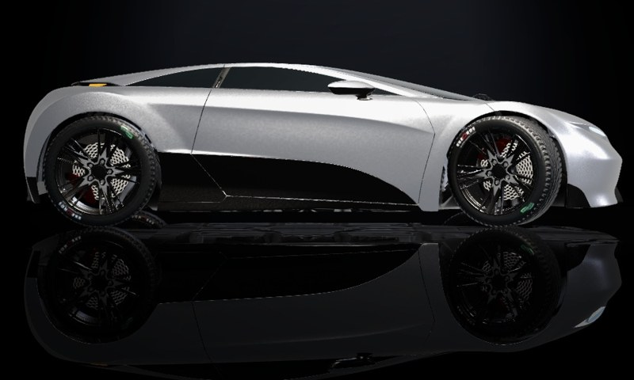
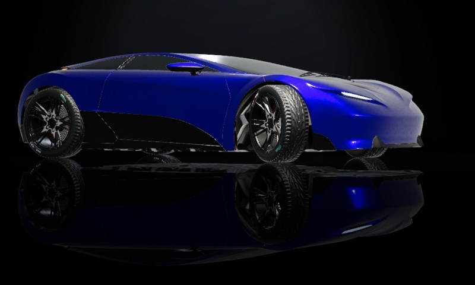
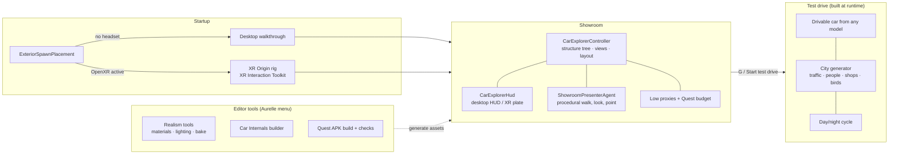

<div align="center">



# Aurelle — VR Car Showroom & City Test Drive

**Walk into a premium car dealership in virtual reality, take a concept car apart down to its last bolt, then drive any car on the floor through a living city.**


AR/VR course project · Central Asian University, Tashkent

</div>

---

## Overview

**Aurelle** is a fictional car brand, and this project is its virtual flagship store. A visitor wearing a **Meta Quest 3**, or walking in first person on a desktop, arrives at a glazed showroom, is welcomed by an animated presenter, and can:

1. **Explore** the hero concept car as an interactive engineering model: switch to X-ray, explode it, and take any of its **1,302 parts** out one level at a time, with descriptions in English and Uzbek.
2. **Test-drive** any car in the collection: walk to it, open the door, sit in a head-tracked cabin and drive through a city with a day/night cycle, traffic, pedestrians, enterable shops, a beach and birds.

Everything runs from a single scene. The desktop walkthrough is the default, and the XR rig takes over automatically when a headset is active.

<p align="center">
  
  
  
</p>
<p align="center"><sub>Studio renders made in the project (<code>InteriorPosterRenderer</code>). Hero car: “CarConcept” by Eric Chadwick, Darmstadt Graphics Group GmbH (Khronos glTF Sample Assets), <a href="https://creativecommons.org/licenses/by/4.0/">CC BY 4.0</a>, rendered and modified.</sub></p>

## Highlights

| | Feature | What it does |
| --- | --- | --- |
| 🏛️ | **Showroom** | Glazed dealership with baked lighting, a studio softbox and planar reflection over the hero car, automatic glass doors and a premium collection (BMW M3 E30, BMW M4 Competition, Tesla Model 3) |
| 🔧 | **Car Explorer** | A structure tree of **13 systems → 54 assemblies → 1,302 parts**. Normal, X-ray and exploded views. Assemblies fly out toward the visitor along collision-free paths and open level by level |
| 🧑‍💼 | **Presenter** | Remy, a procedurally animated guide (no animation controller), welcomes the visitor, keeps out of their sight lines and points at the selected part |
| 🚗 | **Test drive** | Every display car is drivable: door, seat, steering wheel and gauges come from the model's own geometry. Automatic gearbox (P/R/N/D), ABS, traction control and synthesised engine sound per car |
| 🌆 | **Living city** | 24-minute day/night cycle, street lighting, 24 vehicle types in two-way traffic, pedestrians, cyclists, enterable shops, parks, a beach and sea, pigeons and gulls |
| 🥽 | **Quest-ready** | One-click Android build, a separate Low quality tier with a draw-call budget for Quest, reduced crowds and lights on the headset |

## The Car Explorer in short

| View | What happens |
| --- | --- |
| **Normal** | The assembled car. Click a part and its whole assembly lifts out of the car and comes toward you; click again to open the next level, down to a single part |
| **X-ray** | The body fades into light-blue glass with bright edges; the V6, suspension, seats and internals stay solid in their own materials |
| **Exploded** | Every assembly comes out over 1.5 s in three tiers, like a workshop manual |

The car's internals (double-wishbone and multi-link suspension, steering, brake hydraulics, transaxle, hybrid module, fuel, cooling and electrics: **1,025 parts, ~283k triangles**) are **generated by an editor tool** in a clean CAD style, measured against the car and checked for interference. Each part carries an English and Uzbek name, a description, its system and its material.

## Architecture



- **One scene, two modes.** `ExteriorSpawnPlacement` decides desktop or XR before any other script runs, and falls back to desktop if no headset display starts.
- **Generated content.** The exterior district, the car internals, the bicycles and the realistic materials are built by idempotent editor tools (`Aurelle > …`), so the look can be rebuilt in a fixed order from scripts.
- **Two quality tiers.** PC runs *Ultra* (HDR, Forward+, SSAO, post-processing, planar reflection); Quest runs *Low* with a draw-call budget, LOD culling and the explorer's low-poly proxies.

Details: [Docs/ARCHITECTURE.md](Docs/ARCHITECTURE.md) · full technical reference: [Docs/REFERENCE.md](Docs/REFERENCE.md).

## Tech stack

| Area | Tools |
| --- | --- |
| Engine | Unity **6000.3.12f1**, C# (~53k lines of project scripts and editor tools) |
| Rendering | Universal Render Pipeline 17.3: Forward+ and HDR on PC, a separate Quest renderer |
| XR | OpenXR 1.17.1, XR Plug-in Management 4.6, XR Interaction Toolkit 3.5.1, XR Hands, Meta Quest support |
| Input | Input System 1.19 (the legacy input manager is disabled) |
| Assets | glTFast 6.20 (GLB/glTF), KTX for Unity 3.7 (KTX2/Basis textures), CC0 Poly Haven and ambientCG materials |
| Tooling | Custom editor tools for realism, internals and builds; Git LFS for large binaries |

## Quick start

```sh
git lfs install
git clone https://github.com/Nodirjn/car-showroom.git
```

1. Open the folder in **Unity Hub** with Unity **6000.3.12f1**. For Quest, add **Android Build Support** with OpenJDK and the Android SDK and NDK.
2. Open `Assets/Scenes/SampleScene.unity` and press **Play**.
3. On the desktop, walk with **WASD**, look with the mouse, and press **G** while looking at a car to start a test drive.
4. For the headset, run **Aurelle → Build → Quest APK**, then `adb install -r Builds/Aurelle-Quest.apk` with the Quest in developer mode. The app appears under *Unknown Sources*.

## Controls

**Showroom (desktop):** WASD walk · mouse look · **Tab** free the cursor · **click** a part to take it out or open a level · **F** inspect · **T** X-ray · **O** explode · **R** one step back · **P** structure tree · **Q / U** English / Uzbek · **H** help.
**Showroom (Quest):** trigger selects along the controller ray · grip grabs a part · **A** next view · **B** one step back · thumbsticks move and turn.

**Test drive:**

| Action | Meta Quest 3 | Desktop |
| --- | --- | --- |
| Accelerate / brake | Right trigger / left trigger | W / S |
| Steer | Thumbstick | A / D |
| Handbrake | Right grip | Space |
| Door / get in / get out | A / A / B | E |
| Horn / headlights | Y / X | H / L |
| Chase camera | — | V |
| Back to the showroom | Hold Menu 1.2 s | Hold Backspace |

Every key and button is listed in the [technical reference](Docs/REFERENCE.md#controls) and in [Docs/TEST_DRIVE.md](Docs/TEST_DRIVE.md).

## Repository layout

```text
Assets/Scenes/        SampleScene.unity: the only scene in the build
Assets/Scripts/       Car Explorer, HUD, presenter, desktop walkthrough, exterior agents, rendering
Assets/Scripts/TestDrive/  City test drive, built at runtime
Assets/Editor/        Realism tools, Car Internals builder, Quest build and checks
Assets/Models/        Hero car, V6, showroom collection, presenter, generated meshes
Docs/                 Architecture, technical reference, test drive, credits, images
```

## Team

| Role | Member | Responsibilities |
| --- | --- | --- |
| Project coordinator & documentation | **Ibrohim Abralov** | Requirements, README, slides, repository organisation |
| Unity XR & interaction | **Bobur Uchqunov** | XR Origin, OpenXR / Quest setup, `CarExplorerController`, XRI interactions |
| 3D assets, environment & optimisation | **Nodirjon Habibullaev** | Vehicle hierarchy, showroom scene, Remy, Quest performance, city test drive |
| Testing, evaluation & presentation | **Abdurashid Abdusattarov** | Device testing, usability sessions, demo rehearsal |

## Status and known limitations

The APK builds and its manifest was checked, but it **has not yet been run on a headset**: XR paths were tested in Editor simulations with a Quest-like camera. The heaviest explorer states exceed the Quest draw-call budget. Some third-party assets have open licensing questions. All of this is documented in [Known limitations](Docs/REFERENCE.md#known-limitations).

## Documentation

- [Docs/REFERENCE.md](Docs/REFERENCE.md): getting started in depth, building for Quest, what the scene contains, visual quality, editor tools, all controls, packages, known limitations
- [Docs/ARCHITECTURE.md](Docs/ARCHITECTURE.md): scripts, startup order, the Car Explorer and its contracts, the presenter, editor tools, rendering, measured frame cost
- [Docs/TEST_DRIVE.md](Docs/TEST_DRIVE.md): the city test drive, its scripts, controls and tuning
- [CONTRIBUTING.md](CONTRIBUTING.md) · [CHANGELOG.md](CHANGELOG.md) · [THIRD_PARTY_NOTICES.md](THIRD_PARTY_NOTICES.md)

## License

The project's own code and content are under the [MIT License](LICENSE). Third-party models, textures, fonts, samples, shader code and packages keep their own licences, listed in [THIRD_PARTY_NOTICES.md](THIRD_PARTY_NOTICES.md).
